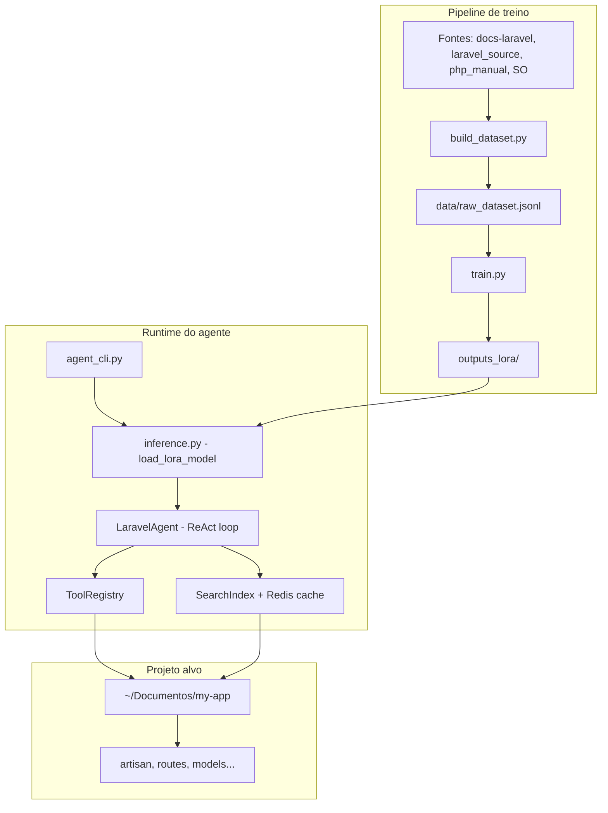

# Arquitetura — Laravel AI Coder

Documento de referência para agentes de IA que programam neste ecossistema. Leia **antes** de alterar código.

---

## 1. Visão geral

**Laravel AI Coder** não é uma aplicação Laravel. É um **projeto Python** que:

1. **Fine-tuna** um LLM local (Qwen2.5-Coder-7B via Unsloth/QLoRA) com conhecimento PHP/Laravel.
2. **Opera um agent CLI** (DRAXY) que edita projetos Laravel reais em `~/Documentos`.
3. **Indexa** documentação e código-fonte Laravel para busca contextual.

### Objetivos

| Objetivo | Como |
|----------|------|
| Assistência offline em PHP/Laravel | LoRA treinado em `data/raw_dataset.jsonl` |
| Debug e scaffolding autônomo | Agent CLI com ferramentas (read/write/grep/artisan) |
| Baixo custo / privacidade | Inferência 100% local em GPU NVIDIA (CUDA) |
| Projetos isolados | Workspace por pasta em `AGENT_PROJECTS_ROOT` |

### Hardware alvo

- GPU: NVIDIA RTX 3060 12 GB VRAM
- RAM: 16 GB
- Python: 3.14 (Ubuntu 26.04)
- PHP/Laravel alvo: **Laravel 11+** (projetos testados com Laravel 13)

---

## 2. Diagrama de alto nível



---

## 3. Módulos e responsabilidades

### 3.1 Raiz do projeto (`laravel-ai-coder/`)

| Arquivo / pasta | Responsabilidade |
|-----------------|------------------|
| `agent_cli.py` | Ponto de entrada do agente interativo |
| `inference.py` | Carrega modelo base + LoRA; geração simples |
| `train.py` | Fine-tuning QLoRA com Unsloth |
| `build_dataset.py` | Gera `data/raw_dataset.jsonl` das fontes |
| `build_search_index.py` | Índice invertido para busca |
| `build_agent_recipes.py` | Receitas de tarefas do agente |
| `config.py` | `TrainingConfig`, `AgentConfig` (dataclasses) |
| `utils/agent/llm_config.py` | Idioma, tolerância a typos, instruções de prompt |
| `config/agent_shortcuts.json` | Atalhos `/model`, `/migration`, etc. |
| `config/search_priorities.json` | Boost de termos na busca |
| `data/` | Dataset, índice, sessões JSON |
| `outputs_lora/` | Adaptador LoRA treinado |
| `utils/agent/` | Núcleo do agente (loop, tools, permissões) |
| `laravel_source/` | Clone do framework Laravel (fonte de treino) |
| `docs-laravel/` | Documentação Laravel (fonte de treino) |

### 3.2 `utils/agent/` — núcleo do agente

| Módulo | Função |
|--------|--------|
| `agent.py` | Loop ReAct: gera JSON → executa tool → repete até `finish` |
| `prompts.py` | System prompt, formato JSON obrigatório, regras Laravel |
| `tools.py` | `read_file`, `write_file`, `grep`, `run_command`, `search`, etc. |
| `modes.py` | `ask` (leitura), `plan` (planejar), `agent` (executar) |
| `permissions.py` | Aprovação interativa de writes e comandos destrutivos |
| `preflight.py` | Scaffolding determinístico (novo projeto, model, login) |
| `workspace.py` | Resolve projetos em `AGENT_PROJECTS_ROOT` |
| `search_index.py` | Busca invertida (dataset + workspace + referência) |
| `session.py` | Persistência de conversas em `data/sessions/` |
| `shortcuts.py` | Resolve atalhos do JSON de config |
| `cache.py` | Cache Redis ou memória para buscas repetidas |

### 3.3 Projeto Laravel alvo (workspace)

Projetos vivem em `AGENT_PROJECTS_ROOT` (padrão: `~/Documentos`). Exemplos: `login-app`, `atendimento-whatsapp`, `teste1`.

Estrutura típica **Laravel 11+/13**:

```
my-app/
├── app/
│   ├── Http/Controllers/
│   ├── Models/
│   └── Providers/AppServiceProvider.php
├── bootstrap/app.php          # Rotas web/api/console registradas aqui
├── config/
├── database/migrations/
├── routes/web.php
├── routes/api.php
├── storage/logs/laravel.log   # Debug principal
├── artisan
├── composer.json
└── tests/Feature|Unit/
```

**Não modifique** `vendor/`, `node_modules/`, `.git/` no workspace alvo.

---

## 4. Fluxo de requisição (Agent CLI)

### 4.1 Inicialização

```
agent_cli.py
  → WorkspaceManager.resolve_startup()   # -p, -w ou AGENT_DEFAULT_PROJECT
  → load_lora_model()                    # Unsloth + PeftModel
  → SearchIndex.load_global() + index_workspace()
  → ToolRegistry + PermissionManager
  → LaravelAgent + SessionManager
```

### 4.2 Loop de uma tarefa

```
Usuário digita tarefa
  → shortcuts.resolve() (opcional)
  → run_preflight() (projeto novo / model / login)
  → LaravelAgent.run()
       para cada step (max AGENT_MAX_ITERATIONS):
         1. Monta messages (system + histórico + tarefa)
         2. model.generate() → texto
         3. _parse_action() → JSON {action: tool|finish}
         4. Se tool: ToolRegistry.run() → feedback ao modelo
         5. Se finish: retorna message
  → sessions.append_turn()
```

### 4.3 Formato de resposta da LLM (obrigatório)

```json
{"action": "tool", "tool": "read_file", "args": {"path": "routes/web.php"}}
```

```json
{"action": "finish", "message": "Corrigido o bug em UserController..."}
```

Um JSON por turno. O parser tolera markdown fences e typos leves no JSON.

### 4.4 Modos de operação

| Modo | Ferramentas | Uso |
|------|-------------|-----|
| `ask` | leitura + search | Perguntas, análise de código |
| `plan` | leitura + search | Plano numerado; usuário aprova com `execute` |
| `agent` | todas | Edição, artisan, criar projeto |

---

## 5. Integração com a LLM local

### 5.1 Modelo

- **Base:** `unsloth/Qwen2.5-Coder-7B-Instruct-bnb-4bit` (4-bit, ~6 GB VRAM)
- **Adaptador:** `outputs_lora/` (gerado por `train.py`)
- **Tokenizer:** chat template Qwen (mensagens `system` / `user` / `assistant`)

### 5.2 Configuração

| Variável `.env` | Default | Descrição |
|-----------------|---------|-----------|
| `MODEL_NAME` | unsloth/...-bnb-4bit | Modelo HuggingFace |
| `MAX_SEQ_LENGTH` | 1536 | Contexto máximo |
| `LORA_OUTPUT_DIR` | ./outputs_lora | Pasta do adaptador |
| `AGENT_TEMPERATURE` | 0.3 | Criatividade (agent) |
| `AGENT_MAX_NEW_TOKENS` | 1024 | Tokens por resposta |
| `LLM_MULTILINGUAL` | true | Aceita pt/en |
| `LLM_DEFAULT_LANGUAGE` | pt | Fallback de idioma |
| `LLM_TYPO_TOLERANCE` | true | Interpreta intenção com erros |
| `LLM_RESPOND_IN_PROMPT_LANGUAGE` | true | Responde no idioma do prompt |

Instruções injetadas via `utils/agent/llm_config.py` → `utils/agent/prompts.py` → system prompt.

### 5.3 Como o agente CLI deve se comunicar com a LLM

**Entrada:** texto livre em português ou inglês (com typos aceitos).

**Exemplos de prompts eficazes:**

```text
# PT — debug
Erro 500 ao registrar usuário. Verifique o log e o AuthController.

# EN — scaffold
Create a Product model with migration, fillable name and price, and a JSON controller.

# PT com typo (aceito)
crie um cntroler UserController com metodos index e store

# Atalhos (bypass parcial da LLM)
/model Product
/migration create_products_table
/log
/search model fillable
```

**Saída esperada da LLM:** JSON de ação (não prose longa) durante o loop ReAct; mensagem final em `finish.message`.

**Inferência simples (sem tools):**

```bash
python inference.py
# Digite instruções; gera código PHP diretamente
```

### 5.4 Endpoints / SDK

Não há API HTTP. A LLM é invocada via:

- `transformers` + `model.generate()` em `agent.py` e `inference.py`
- Sem OpenAI-compatible server neste repo

---

## 6. Padrões de design adotados

### Neste repo (Python)

| Padrão | Onde |
|--------|------|
| **Dataclass Config** | `config.py`, `utils/agent/llm_config.py` |
| **Registry** | `ToolRegistry`, `ShortcutRegistry` |
| **ReAct loop** | `LaravelAgent.run()` |
| **Strategy (modos)** | `modes.py` — conjuntos de tools por modo |
| **Preflight / Template Method** | `preflight.py` — fluxos determinísticos antes da LLM |
| **Facade** | `agent_cli.py` orquestra subsistemas |

### Nos projetos Laravel alvo (convenção esperada)

| Padrão | Uso |
|--------|-----|
| **MVC** | Controllers finos, lógica em Services quando crescer |
| **Form Request** | Validação em classes dedicadas |
| **Eloquent** | Models com `$fillable`, `casts()`, relationships |
| **Service Provider** | Bindings em `AppServiceProvider` |
| **Resource API** | `JsonResource` para respostas JSON |
| **Policy/Gate** | Autorização (quando aplicável) |
| **Events/Listeners** | Side effects desacoplados |
| **Repository** | Opcional; não é padrão default do skeleton Laravel |

O agente deve **seguir o que já existe** no projeto alvo antes de introduzir novas camadas.

---

## 7. Convenções de nomenclatura

### Python (este repo)

- Módulos: `snake_case`
- Classes: `PascalCase`
- Config via env: `SCREAMING_SNAKE_CASE`
- Indentação: 2 espaços (padrão do projeto)

### PHP/Laravel (workspace alvo)

- Classes: `PascalCase` (`UserController`, `ProductService`)
- Métodos/variáveis: `camelCase`
- Tabelas/colunas DB: `snake_case` plural para tabelas
- Migrations: `create_products_table`
- Rotas: kebab ou snake em URLs; nomes de rota com dot notation
- Namespaces: PSR-4 `App\`

---

## 8. Dependências externas relevantes

### Python (`requirements.txt`)

- `unsloth`, `transformers`, `peft`, `trl`, `bitsandbytes` — ML
- `torch` (CUDA 12.6) — inferência GPU
- `redis` — cache opcional
- `python-dotenv` — variáveis de ambiente

### PHP (projeto alvo)

- PHP ^8.3
- `laravel/framework` ^13.x (nos projetos atuais)
- `laravel/installer` global para `create_laravel_project`
- Composer, PHPUnit, Pint

### Sistema

- NVIDIA driver + CUDA
- Redis opcional (`redis-server`)
- `laravel` CLI global: `composer global require laravel/installer`

---

## 9. Como o agente CLI deve interagir

### Comandos principais

```bash
# Sempre ativar venv
source .venv/bin/activate

# Agent interativo
python agent_cli.py -p login-app
python agent_cli.py -w ~/Documentos/my-app

# Tarefa única
python agent_cli.py -p login-app -t "listar rotas da API"

# Modos
python agent_cli.py --mode ask -p login-app
python agent_cli.py --mode plan -p login-app

# Sem aprovação (CI/headless)
python agent_cli.py --force -t "php artisan route:list"

# Reindexar workspace
python agent_cli.py --reindex -p login-app
```

### Comandos artisan permitidos (via `run_command`)

Prefixos seguros: `php`, `composer`, `laravel`, `grep`, `ls`, `find`, etc.

Artisan normalizado automaticamente: `make:model Foo -m` → `php artisan make:model Foo -m`

**Bloqueados:** `rm`, `sudo`, `curl`, `wget`, `chmod`, pipes para shell.

### Testes no projeto Laravel alvo

```bash
cd ~/Documentos/login-app
php artisan test
# ou
composer test
```

O agente deve rodar testes após mudanças significativas.

### Antes de implementar

1. Ler `ARCH.md` (este arquivo)
2. Consultar skill `.cursor/skills/laravel-best-practices/`
3. `read_file` / `grep` / `search` no código existente
4. `tail_log` se houver erro em runtime

---

## 10. Pontos de atenção (evitar regressões)

### Neste repositório

| Risco | Mitigação |
|-------|-----------|
| OOM na GPU | `batch_size=1`, `MAX_SEQ_LENGTH=1536`, fechar apps GPU |
| Quebrar parser JSON | Manter formato `{"action":"tool"|"finish",...}` no prompt |
| Paths fora do workspace | `ToolRegistry._resolve_path()` bloqueia escape |
| LoRA ausente | Aviso em log; usa modelo base sem especialização |
| venv não ativado | `externally-managed-environment` no pip |

### No projeto Laravel alvo

| Risco | Mitigação |
|-------|-----------|
| `migrate:fresh` em produção | `PermissionManager` pede aprovação |
| Editar `vendor/` | Nunca; usar Composer |
| Rotas API não registradas | Verificar `bootstrap/app.php` tem `api:` |
| Mass assignment | Sempre `$fillable` ou `$guarded` |
| N+1 queries | `with()` / eager loading |
| Cache de config em dev | `php artisan config:clear` após mudar `.env` |
| `.env` commitado | Nunca escrever secrets em arquivos versionados |

### Preflight automático

Estes fluxos **não dependem** da LLM e não devem ser duplicados manualmente:

- `create_laravel_project` — novo app em Documentos
- `try_scaffold_model` — `php artisan make:model X -m`
- `try_scaffold_login` — AuthController + rotas API + seeder

### Isolamento multi-agente (repo pai `IA-LARAVEL`)

Se operar no monorepo pai, workers só escrevem em `workspaces/<nome>/`. Este projeto (`laravel-ai-coder/`) é o runtime do DRAXY — integração via coordenador em `shared/`.

---

## 11. Estrutura de diretórios (resumo)

```
laravel-ai-coder/
├── ARCH.md                    ← este documento
├── README.md
├── agent_cli.py
├── inference.py
├── train.py
├── config.py
├── config/
│   ├── agent_shortcuts.json
│   └── search_priorities.json
├── data/
│   ├── raw_dataset.jsonl
│   ├── search_index.json
│   ├── agent_recipes.jsonl
│   └── sessions/
├── outputs_lora/              ← adaptador treinado
├── utils/agent/               ← núcleo do agente
│   ├── llm_config.py          ← comportamento multilíngue
├── .cursor/
│   ├── skills/laravel-best-practices/
│   └── rules/laravel-agent.mdc
├── laravel_source/            ← fonte de treino (read-only)
└── docs-laravel/              ← docs de treino (read-only)
```

---

## 12. Referências rápidas

| Preciso de... | Onde olhar |
|---------------|------------|
| Variáveis de ambiente | `.env.example` |
| Atalhos do CLI | `config/agent_shortcuts.json` |
| System prompt | `utils/agent/prompts.py` |
| Tools disponíveis | `utils/agent/tools.py` |
| Modos ask/plan/agent | `utils/agent/modes.py` |
| Skill Laravel | `.cursor/skills/laravel-best-practices/SKILL.md` |
